

<picture>
  <source media="(max-width: 520px)" srcset="assets/header-narrow.svg">
  <source media="(max-width: 767px)" srcset="assets/header-medium.svg">
  <source media="(max-width: 859px)" srcset="assets/header-narrow.svg">
  <source media="(max-width: 1219px)" srcset="assets/header-medium.svg">
  
</picture>

 

  

<picture>
  <source media="(max-width: 520px)" srcset="assets/whoami-narrow.svg">
  <source media="(max-width: 767px)" srcset="assets/whoami-medium.svg">
  <source media="(max-width: 859px)" srcset="assets/whoami-narrow.svg">
  <source media="(max-width: 1219px)" srcset="assets/whoami-medium.svg">
  
</picture>

I build AI infrastructure for places where the network is not a given, and the engine that
makes it fast once it is there. I work across the whole stack, from TPM-bound boot chains
and hand-written CUDA kernels to cross-platform Flutter and React applications, and I back
technical claims with measurements.

---

## Two companies, one stack

**[IronGap Technologies](https://www.iron-gap.com)** decides *where* the model runs: on
hardware you physically control, behind an air gap, for defence, healthcare and regulated
enterprises. **VEYMEER** decides *how fast* it runs once it is there: a from-scratch LLM
inference engine for consumer GPUs. They are sister companies, and the second plugs into
the first.

### Vault-OS · IronGap

An enterprise air-gapped AI knowledge vault. Offline LLM and RAG, shipping on Windows.

<picture>
  <source media="(max-width: 520px)" srcset="assets/vault-narrow.svg">
  <source media="(max-width: 767px)" srcset="assets/vault-medium.svg">
  <source media="(max-width: 859px)" srcset="assets/vault-narrow.svg">
  <source media="(max-width: 1219px)" srcset="assets/vault-medium.svg">
  
</picture>

- **Native, without Docker.** Fastify, React 19 and PostgreSQL/pgvector, with the database
  managed by the product itself inside an encrypted enclave and its schema repaired on
  every boot.
- **Fail-deadly security model.** AES-256-GCM sealed configuration with scrypt key
  derivation, a TPM 2.0-bound enclave with hardware-tethered licensing, an ECDSA-signed,
  SHA-256 hash-chained audit ledger, clock-integrity checks and NIST SP 800-88 secure
  erasure.
- **Pluggable inference.** Ollama, vLLM, TensorRT-LLM, anything OpenAI-compatible, and
  VEYMEER, under a DAG workflow and agent engine with sandboxed execution.
- **A bare-metal appliance.** A Rust-based OS with its own PID 1 init, initramfs builder,
  desktop shell and compute fabric, disk provisioning with TPM-sealed LUKS2, and a QEMU
  test harness.
- **Clients everywhere the operator is.** A Flutter app for Android, iOS, Windows, macOS
  and Linux with local-network discovery and certificate pinning, an Electron desktop
  client, and installers with silent chained setup and conflict diagnostics.

**[IronGap on GitHub →](https://github.com/IronGap-Technologies)**

### VEYMEER

The same model on the same GPU, several times faster, with identical output.

<picture>
  <source media="(max-width: 520px)" srcset="assets/veymeer-narrow.svg">
  <source media="(max-width: 767px)" srcset="assets/veymeer-medium.svg">
  <source media="(max-width: 859px)" srcset="assets/veymeer-narrow.svg">
  <source media="(max-width: 1219px)" srcset="assets/veymeer-medium.svg">
  
</picture>

Those numbers come from a laptop GPU, on purpose. The speculative decoding is lossless:
the output is identical to standard decoding, so the only thing that changes is how long
you wait.

<picture>
  <source media="(max-width: 520px)" srcset="assets/engine-narrow.svg">
  <source media="(max-width: 767px)" srcset="assets/engine-medium.svg">
  <source media="(max-width: 859px)" srcset="assets/engine-narrow.svg">
  <source media="(max-width: 1219px)" srcset="assets/engine-medium.svg">
  
</picture>

Every box in that row is written here, from the GGUF loader to the API, with the CUDA
kernels compiled at runtime via NVRTC and a WebGPU backend for AMD, Intel and Apple GPUs.
**STRADA** is what it looks like with an editor on top: a desktop IDE with VS Code
extension support, integrated debugging and an autonomous coding agent.

---

## How I got here

I did not start with security. I started with a plant in Golestan that could not afford to
have its systems go down, and a job keeping them up through the construction and
commissioning of an iodine extraction facility. More than two years of that teaches you
something a course cannot: that the interesting failures are never the ones in the design
document, and that "it works on my machine" is a sentence with real consequences when the
machine is in a control room.

Then I started building software for environments where the network is not a given, and
found the same lesson waiting. So I stopped treating isolation as a constraint to work
around and started treating it as the thing worth building. In September 2026 the same
instinct went one layer down, into the inference engine itself.

<picture>
  <source media="(max-width: 520px)" srcset="assets/timeline-narrow.svg">
  <source media="(max-width: 767px)" srcset="assets/timeline-medium.svg">
  <source media="(max-width: 859px)" srcset="assets/timeline-narrow.svg">
  <source media="(max-width: 1219px)" srcset="assets/timeline-medium.svg">
  
</picture>

None of those bars has ended except the first. The plant, the degree and both companies
run at the same time.

---

## The range

Most of what I do sits at the seams. Not the frontend, not the backend — the awkward joints
where a TPM chip has to convince a database that a license is valid, where a Flutter
client has to find an appliance on a network with no DNS and no internet, or where a
kernel compiled at runtime has to produce the same token a reference implementation would.

<picture>
  <source media="(max-width: 520px)" srcset="assets/depth-narrow.svg">
  <source media="(max-width: 767px)" srcset="assets/depth-medium.svg">
  <source media="(max-width: 859px)" srcset="assets/depth-narrow.svg">
  <source media="(max-width: 1219px)" srcset="assets/depth-medium.svg">
  
</picture>

I do not claim equal depth at every layer. I claim I can move between them without needing
someone to translate, which on a small team is the thing that actually matters.

<picture>
  <source media="(max-width: 520px)" srcset="assets/reach-narrow.svg">
  <source media="(max-width: 767px)" srcset="assets/reach-medium.svg">
  <source media="(max-width: 859px)" srcset="assets/reach-narrow.svg">
  <source media="(max-width: 1219px)" srcset="assets/reach-medium.svg">
  
</picture>

---

## How I work

**I optimise for the failure case.** The happy path is the easy half. Most of the design
work in Vault-OS went into what happens when the install loses power at 18GB, when the
measurement doesn't match, when the operator loses the password. Shutdown *verifies* the
enclave locked rather than assuming it — because assuming is how you find out six months
later.

**I remove dependencies rather than manage them.** Every layer you add is a layer that can
fail, be compromised, or be discontinued by someone else's business decision. Vault-OS runs
PostgreSQL natively instead of in a container, not because containers are bad, but because
a container runtime is one more thing between me and a guarantee I have to make in writing.
VEYMEER is the same argument taken to its end: the engine is written from scratch.

**I prefer claims that can be falsified.** "Military-grade" means nothing. "SHA-256
hash-chained, ECDSA-signed, and here is the ledger" either verifies or it doesn't. The
same goes for speed: "12–15× faster" comes with the GPU, the model, the task and the
condition that the output is identical, because every one of those qualifiers is part of
the claim. When I can't check a number I'd rather not write it.

**I build for the operator, not the demo.** Tiered clearance and server-enforced
retention are unglamorous. They are also what someone actually needs at 2am when a
contractor's access has to be revoked before the audit.

**I read the standard.** NIST SP 800-88 exists, is specific about what erasure means, and
is more useful than any blog post about secure deletion. Most of the hard problems have
been thought about carefully by someone else first.

<picture>
  <source media="(max-width: 520px)" srcset="assets/method-narrow.svg">
  <source media="(max-width: 767px)" srcset="assets/method-medium.svg">
  <source media="(max-width: 859px)" srcset="assets/method-narrow.svg">
  <source media="(max-width: 1219px)" srcset="assets/method-medium.svg">
  
</picture>

---

## Also built

<picture>
  <source media="(max-width: 520px)" srcset="assets/portfolio-narrow.svg">
  <source media="(max-width: 767px)" srcset="assets/portfolio-medium.svg">
  <source media="(max-width: 859px)" srcset="assets/portfolio-narrow.svg">
  <source media="(max-width: 1219px)" srcset="assets/portfolio-medium.svg">
  
</picture>

### Lumo

Decentralised collision avoidance for autonomous drones, in Python and Rust. Sixty drones
swapping sides through a single point is the worst case there is, and without help it ends
in 717 collisions. A speed governor derived from turning physics, `v ≤ √(a·g)`, takes that
to zero with every drone still reaching its goal, and without a central planner telling
anyone where to go.

<picture>
  <source media="(max-width: 520px)" srcset="assets/swarm-narrow.svg">
  <source media="(max-width: 767px)" srcset="assets/swarm-medium.svg">
  <source media="(max-width: 859px)" srcset="assets/swarm-narrow.svg">
  <source media="(max-width: 1219px)" srcset="assets/swarm-medium.svg">
  
</picture>

### YTU BME Nexus

Department platform for Biomedical Engineering at Yıldız Technical. `React` `Supabase`

Web, Android, iOS and desktop, in 13 languages, with row-level security throughout. GPA
calculator, timetable, messaging, file sharing and a department knowledge base. Built for
the department I actually study in, which is a useful constraint — the users find me in
the corridor.

### [Traces](https://github.com/taha-halakoo/Lumo-traces)

Content pinned to physical coordinates, locked until you're within 20 m. `Fastify` `PostGIS` `pgvector` `Flutter`

PostGIS geofencing with anti-spoofing checks, combined vector and spatial ranking, and an
offline-first mobile client. The proximity constraint is enforced server-side — the client
is never trusted with it.

### rremote

Secure remote desktop over encrypted WebSockets. `Rust` `Tokio`

An asynchronous server for screen sharing, remote input, terminal sessions, audio and
camera streaming, with local-network discovery and QR-code pairing.

### Aegis

Hydrogen-electric VTOL cargo drone for medical and disaster-relief logistics, in concept
phase. `Systems engineering` `Python`

Concept of operations, traceable requirements, design decisions, an in-house aerodynamics
model, and mass and power budgets.

### [Virtual Mouse](https://github.com/taha-halakoo/virtual-mouse)

Hands-free pointer control from webcam hand tracking. `Python` `MediaPipe` `OpenCV`

One-Euro filtering with relative delta tracking. A clutch gesture lets you reposition your
arm without moving the cursor — the detail that makes it usable rather than a demo.

### [StudyHub](https://github.com/taha-halakoo/studyhub)

Modular productivity dashboard with real-time collaboration. `React` `TypeScript` `Supabase`

Lazy-loaded feature modules and role-based access over Supabase Auth.

Also: **WidgetOS**, a platform for embeddable Notion widgets (Next.js, Drizzle, Stripe);
the IronGap Founder Console with TOTP login, an MCP server that gives AI agents audited
access to it, and a content pipeline that drafts posts from development activity and
publishes only after approval; a multilingual B2B platform for Golestan Axon; and several
production websites.

---

## What the biomedical degree is actually for

People assume it's unrelated. It isn't, and not for the reason you'd guess.

Biomedical engineering is the discipline of building things that fail safely around people
who cannot consent to the risk — where the regulatory burden is the engineering, not
paperwork stapled to it afterwards. That is the same instinct behind an air-gapped
appliance for a hospital or a defence contractor. Signal processing, control systems and the
statistics of measurement all transfer directly. The habit of treating a compliance regime
as a design input transfers even more.

It also keeps me honest about the AI hype. When you've studied how hard it is to validate a
medical device, you become suspicious of anything that claims to work because it demoed
well.

<picture>
  <source media="(max-width: 520px)" srcset="assets/bme-narrow.svg">
  <source media="(max-width: 767px)" srcset="assets/bme-medium.svg">
  <source media="(max-width: 859px)" srcset="assets/bme-narrow.svg">
  <source media="(max-width: 1219px)" srcset="assets/bme-medium.svg">
  
</picture>

---

## Signal

<picture>
  <source media="(max-width: 520px)" srcset="assets/stats-narrow.svg">
  <source media="(max-width: 767px)" srcset="assets/stats-medium.svg">
  <source media="(max-width: 859px)" srcset="assets/stats-narrow.svg">
  <source media="(max-width: 1219px)" srcset="assets/stats-medium.svg">
  
</picture>

 

<picture>
  <source media="(max-width: 520px)" srcset="assets/contrib-narrow.svg">
  <source media="(max-width: 767px)" srcset="assets/contrib-medium.svg">
  <source media="(max-width: 859px)" srcset="assets/contrib-narrow.svg">
  <source media="(max-width: 1219px)" srcset="assets/contrib-medium.svg">
  
</picture>

 

<picture>
  <source media="(max-width: 520px)" srcset="assets/velocity-narrow.svg">
  <source media="(max-width: 767px)" srcset="assets/velocity-medium.svg">
  <source media="(max-width: 859px)" srcset="assets/velocity-narrow.svg">
  <source media="(max-width: 1219px)" srcset="assets/velocity-medium.svg">
  
</picture>

Whatever shape that last chart has when you read this, it is the real one, flat stretches
included. I would rather show you the ramp than claim I have been doing this for a decade.

<picture>
  <source media="(max-width: 520px)" srcset="assets/rhythm-narrow.svg">
  <source media="(max-width: 767px)" srcset="assets/rhythm-medium.svg">
  <source media="(max-width: 859px)" srcset="assets/rhythm-narrow.svg">
  <source media="(max-width: 1219px)" srcset="assets/rhythm-medium.svg">
  
</picture>

I don't commit every day and I'm not going to pretend otherwise. Fewer than half the days,
but a dozen or so commits on each of them — I work in long sessions rather than keeping a
streak alive, and I'd rather the graph said something true than something tidy.

Every panel on this page, down to the link buttons, is drawn by <a href="scripts/">scripts in this repo</a>
and refreshed daily, rather than fetched from a third-party widget — the usual ones
rate-limit, run out of quota, and eventually stop rendering. Each is drawn in three
layouts, so it stays readable from a phone to a wide monitor. Fitting, for someone who
builds things that don't phone home.

---

Founder & Chief Architect at **[IronGap Technologies](https://www.iron-gap.com)** · Founder & Engine Architect at **VEYMEER** · Istanbul, Türkiye
Biomedical Engineering at **Yıldız Technical University** · MATE R&D, Polaris Group

[iron-gap.com](https://www.iron-gap.com) · [LinkedIn](https://www.linkedin.com/in/taha-halakooei) · [taha@iron-gap.com](mailto:taha@iron-gap.com)

 

<i>Isolation you can verify beats assurance you have to trust.</i>

